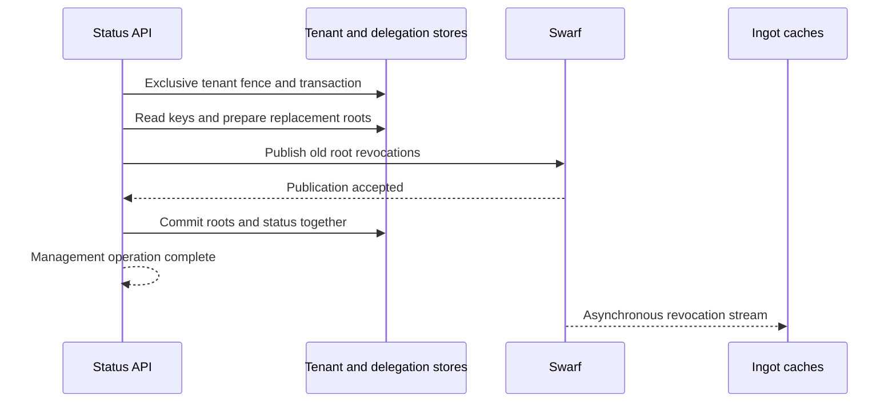

# Tenant status and stored authority

The partner status API reconciles status and every current access key's stored
root delegations. It publishes revocations to Swarf before committing the new
status and roots in the same Postgres transaction. A publish failure leaves the
old database state in place. Reapplying the same status reconciles roots issued
by an older writer; revoked CIDs are never reused.

Access-key creation, policy grant rotation, and authorize response construction
hold the same tenant fence shared. Each reads the status under that fence and
keeps it through authority persistence or parent-chain attachment. A status
change therefore includes an earlier writer's roots or finishes before a later
writer reads the restricted status. Locks and the grant batch have bounded
waits; a failed operation must be retried.

`disabled` stores no root authority. `write-locked` keeps recognized read/list
operations and storage cleanup: object/version/batch/bucket deletion and
multipart abort. Configuration and security mutations are denied, including
HTTP DELETE operations on policies, tags, encryption or other configuration.
Unknown S3 operations fail closed under this status. The operation classifier
uses S3 actions, not the HTTP verb. Configured service-key permissions and
principal policies remain intact so restoration can issue fresh roots from
them. Expired keys and removed principals regain no authority.

Write-lock enforcement also filters effective S3 permissions in each authorize
response. Lower-level UCAN commands overlap between allowed cleanup and denied
uploads; a cleanup grant must not imply permission for every S3 action using
those commands. Authorize responses include their exact stored parent roots,
so Ingot can invalidate a response arriving after a revocation it has already
observed.

## Consistency limits

Management completion establishes a durable database transition and Swarf
publication, **not** an acknowledgement from every gateway. Warm requests may
continue before a gateway consumes the revocation. A gateway restart, stream
interruption, or publication followed by database commit failure still requires
separate recovery/acknowledgement design. No propagation deadline or immediate
global cutoff is established here. In-flight storage operations are not rolled
back by a later status change.

Literal cutoff at management completion requires a separate protocol decision:
an authoritative gateway acknowledgement barrier with membership and restart
recovery, or a bounded authorization lease whose expiry the management API
waits for. Either choice must define unavailable gateways, failure behavior,
and outstanding operations. A console-side deny check cannot supply this
provider enforcement guarantee.

## Evidence and operations

Store tests cover memory and real Postgres fencing, cross-tenant independence,
and nested authority transaction rollback. Service tests cover publish failure,
restriction, restoration with fresh CIDs, unchanged controls and configured
permissions, and real Postgres status/root atomicity. RPC and Ingot tests cover
operation classification, parent attachment, warmed cache action separation,
and late responses after an observed revocation. The local Forge integration
`TestForge/TenantStatusRestrictsWarmCaches` exercises the real service path with
two synthetic tenants, original valid signed URLs, cleanup-warmed denial of
writes and configuration changes, and restoration. Local test results are not
deployed acceptance or proof of a propagation deadline.

Stable logs `tenant status authority change failed` and
`committed tenant status and authority change` include tenant DID, requested
status and duration, without key material. A companion infra-central alert
should count the failure message; exported failure/duration metrics belong to
FIL-1143 when Hilt metrics are enabled.
